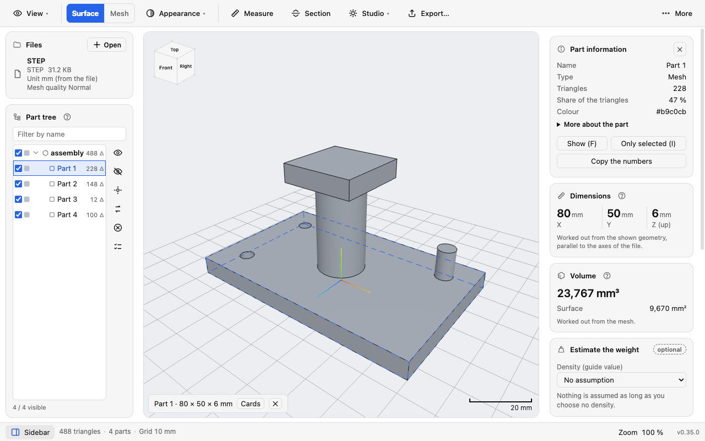
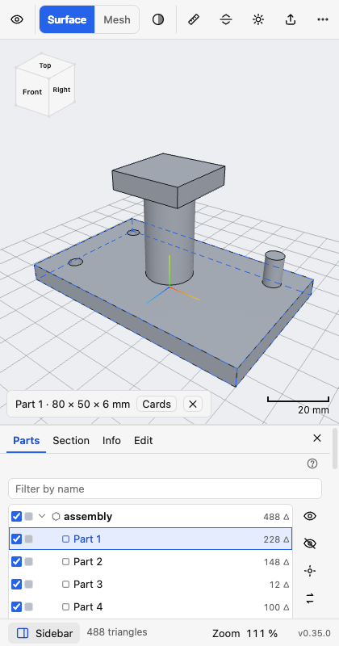

# STEP Viewer 3D for Orca

Open a STEP CAD file (`.step`, `.stp`) in Orca's editor tab and look at it: assemblies and parts as a list with color and
visibility, surface or mesh, mesh quality, and size and unit read from the file. The CAD kernel runs **in a background worker,
offline, with no permissions**.



STEP files hold exact surfaces (B-rep), not triangles. This plugin turns them into triangles with
[occt-import-js](https://github.com/kovacsv/occt-import-js), a WebAssembly build of OpenCascade, and draws them with
three.js. For STL, 3MF, GLB, PLY and OBJ files use the companion plugin **3D Model Viewer**.

## What you can do

- **Look around**: drag to orbit, right-drag or Shift-drag to pan, scroll to zoom (towards the cursor). The **View** menu (or `R`)
  shows everything again. **Surface | Mesh** (`W`), grid (`G`), axes, bounding box, **mesh over the surface** (Appearance > Advanced), backfaces.
- **Parts**: assemblies and parts as an indented list with a checkbox, color swatch and triangle count. Click a part in the
  view to select it, double-click a row to show only that part, **All / None / Invert** change everything, **Color by part**
  gives each part its own color. Colors stored in the STEP file (per part and per face) are shown.
- **Edges**: *Show edges* (Appearance menu, on by default) draws the CAD edges, the lines where two faces of a part meet (made from the converter's face ranges the first time you switch it on; a smooth fillet shows its seams, a flat face shows no triangulation lines). They follow the section plane. A tool that only moves, scales or converts the model keeps them (they are children of the parts); a tool that replaces the triangles (Decimate) makes the edges of those parts again as sharp edges (over 30 degrees), because their faces are not known any more, and says so. A part with more than 6 million triangles gets no edges.
- **Assembly tree**: a group row has a fold button (▾ / ▸, reachable by keyboard) that hides its rows; a filter ignores the folds, and selecting a part in the view unfolds the groups above its row. The group's checkbox shows or hides the whole subtree.
- **View menu** (select or keys `1` to `8`, every view fits the whole model), **section plane** along the file's X, Y or Z with a slider, **measuring** of the
  distance between two surface points (`M`), **shading** (original, solid gray, normals), **opacity**, a **filter** box for long part
  lists, and **Save image…** (in the Studio menu; PNG through Orca's save dialog) and **Export…** (a copy as GLB, STL, OBJ, PLY or 3MF, see below).


- **Layout**: a toolbar on top with a symbol in front of every word (*View*, *Surface | Mesh* with *Appearance*, *Measure*, *Section*, *Studio*, *Export…* and *More*; from 1300 px also *Open*, *Diagonal*, *Front*; the words give way to the symbols when the window is narrow) and a status bar at the bottom with the sidebar button and the numbers of the view (triangles, parts, grid step, zoom), an orientation cube and a scale bar in the view; from 1200 px the sidebar is two columns of cards around the view (*Files* and the *Part tree* on the left; *Section* while a plane is on, *Measurements*, the part cards *Part information*, *Dimensions*, *Volume*, *Estimate the weight* (on request, only where the file states its unit), *Model* and a folded *Edit* on the right); below 1200 px it is one column with the tabs *Parts*, *Section*, *Info* and *Edit* (and *Measurements n* from the first measurement on; a file starts on *Parts* or *Info*, never on an empty tab). Drag the panel's edge to resize it (arrow keys too, double-click resets), fold sections one by one, close it with the button or `P`; all of it is remembered. In a narrow tab or the sidebar (under 520 px) the panel is a sheet under the view and what does not fit on the toolbar even as a symbol (*Studio*, *Export…*, *Section*) is in the **More** menu, which has three groups: files · shortcuts · reset.
- **Mesh quality**: *Coarse*, *Normal* or *Fine*. Changing it reads the file again.
- **Details**: number of parts, B-rep faces, triangles, size along X, Y and Z, height range, grid step, unit, read time and
  the converter's memory.
- **Unit**: read from the file (millimeters, centimeters, meters, inches, feet). Other units (for example micrometers) are
  converted to millimeters and the details say so. If a file names no length unit, millimeters are assumed and the details say so.
- **Orientation**: CAD files are Z up (default); switch to +Y up if a file is not. The choice is remembered.
- **Safe to cancel**: reading runs in a worker. **Cancel** stops it at once and frees its memory.
- **Live**: when the file changes on disk the view updates and the camera stays where it was.
- English and German interface (it follows Orca's language).

## Open without a file: start page, drop, picker

You do not need a file in the workspace. Three ways to get an empty viewer that takes a STEP file:

- **Sidebar panel "STEP"** (right sidebar): always available, shows the start page.
- **New file → "STEP Viewer (drop a model)"** (the + menu of the tab bar or the command palette): opens a tab with the start page.
- Any open viewer tab: **Open** in the toolbar (from 1300 px) or in the *Files* card, or just drop a file onto the view.

On the start page drag a model in from Finder or any folder, or press **Choose file…**. Files one after another replace the view.
Dropped files are read by the browser's File API, so Orca's 50 MB limit for files it hands to an editor does **not** apply. What limits STEP
is the converter: it needs about 43 times the file size in memory (1.5 GB for 34.6 MB) and WebAssembly stops at 4 GB, so files above about
90 MB are refused with a message. The memory warning above 15 MB still asks first. (Measured: a dropped 35 MB assembly shows the memory gate; a
199 MB file shows the "too big" message.)
Several files at once: the first supported one opens, the rest are reported as ignored. A format that is not supported gets a clear message
(other 3D formats point to the companion plugin).

**For an agent:** every time a model is shown the viewer logs one line, `step-viewer-3d-state {...json...}` (file name when it was
dropped or picked, bytes, parts, faces, triangles, size along the file's own axes, unit, quality, read time, converter memory). Read it with
`orca plugin logs local.step-viewer-3d --json` (the key is `<publisher>.step-viewer-3d` for an installed plugin). The picture of the
panel is available with `orca plugin shot <key> --panel viewer`. Limits: the plugin has no permissions, so it cannot write a file or
learn a path (Orca gives frames only the file name of a dropped file, never its location); warnings and errors are the only console
levels `orca plugin logs` keeps, so the state line is a `console.warn`.

- **The last file comes back.** Orca builds a panel's frame anew when the panel is shown again (the right sidebar was closed and opened, another panel was in front), and an editor tab when it is shown again, so what the page held would be gone. The last file you **dropped, chose or pasted** is therefore kept in the plugin's own browser storage (IndexedDB of its frame, this computer only, up to 200 MiB) and opened again when the panel (or the start file) starts without a document, with the camera and the display switches. The next file replaces it; **Close file…** (it asks first) deletes it; a file larger than 200 MiB is not kept (the panel says so). A file Orca opens in an editor tab is never replaced by it. The agent can see frame starts as `step-viewer-3d-boot` lines in `orca plugin logs`.

## Export

**Export…** in the toolbar (or `E`) opens the **Export** dialog: choose **Image**, **Film** or **3D file** (and the format), press **Create copy**,
then **Save as …**: Orca's Save dialog asks where to put it. **The original file is never changed**, and nothing is written without
that click. (It is two steps because the Save dialog needs a fresh click and a large file can take longer to build than a click
stays fresh; it also lets the panel show the size first.)

| Format | What the copy has | What it does not keep |
| --- | --- | --- |
| **GLB** | all parts with their colors and normals (no compression); Y up | the assembly tree (parts become flat nodes) |
| **GLB, compressed** | the same as GLB, made smaller to a target size (see Edit) | exact precision (positions and normals keep fewer bits) |
| **STL** | all triangles as one binary solid; Z up | colors, part names, units |
| **OBJ** | one object per part; colors as vertex colors (`v x y z r g b`) | a material file |
| **PLY** | all parts with vertex colors (binary) | part names |
| **3MF** | geometry, part names, **one color per part**, the unit (core specification) | per-face colors, the assembly tree |
| **PNG** | the current view; a long edge of 1920 or 3840 px; a transparent background draws only the model (no grid, axes or box) | |
| **WebM** | one turn around the model (4, 8 or 15 s), recorded from the view as it is | |

Options: *Only visible parts* leaves out what you hid in the assembly list; *Up in the copy* turns the model so that +Y (glTF), +Z
(CAD, printing) or the file's own axes are up (the default is the format's convention: Y for GLB, Z for STL and 3MF, unchanged
for OBJ and PLY). The panel names what each format loses before you save, and shows the **size of the copy against Orca's limits**:
under 50 MiB Orca can open the copy in a tab; between 50 and 64 MiB it can save it but not open it in a tab (drop it into the viewer
instead); above 64 MiB the Save dialog refuses it, so make the model smaller first (for example a coarser quality).
The triangles are the converter's mesh at the quality you chose, so a finer quality gives a finer copy. The STEP file itself is never rewritten.

## Edit: change the working copy

The **Edit** card of the sidebar (the **Edit** tab below 1200 px) changes the model that is on screen, the *working copy*; the file on disk is never touched and
nothing is saved by a tool. **Export** then writes the working copy, so Edit and export work together. **Back to the file**
undoes everything. After a tool the panel shows the size and triangle numbers before and after (and, for the ones that change the
shape, two small pictures). A 3MF that is written afresh contains no slicer data (painted colors, profiles, plates); a copy as 3MF is written afresh from the triangles (the formats are written, not read here).

- **Compress under a size** (format **GLB, compressed** in the export dialog): the main way to make a file under Orca's 50 MiB. Choose the target size (default 45 MiB) and the precision. Vertices are merged and reordered, positions, normals and colors are stored with fewer bits, and the data is packed with meshopt (`EXT_meshopt_compression`, which the 3D Model Viewer and Orca open). A converted STEP model has no textures. The panel reports *target reached* or *not reachable* with suggestions. It runs in a worker with a progress display and a Cancel button, so the page stays usable. 
- **Transform**: **unit** (convert keeps the real size, *Set as* only says what the numbers mean for a file without a unit), **origin** (center, center on floor, put on floor, corner at 0), **scale**, **rotate** in 90° steps about X, Y or Z, **mirror**, and **make "Up is" part of the model**.
- **Parts**: not offered here: the parts are the leaves of the assembly tree, so hide what you do not need and export only the visible parts.
- **Mesh**: **decimate** to a share of the triangles (detail: careful, normal, reach the target; optionally keep borders) with before and after pictures, and **check mesh** (holes, non-manifold edges, inconsistent orientation, degenerate triangles, separate pieces, volume of a closed mesh). The check only counts; it does not repair.

The compressor, the mesh tools and the measuring are the same code as in the companion plugin **3D Model Viewer**; its README has the measured figures for large files (made with its own test scripts, which this repository does not contain). No such measurement was made with STEP models.

## Looking closer (0.7.0)

- **Shading**: original, solid gray, normals, **X-ray**, **matcap**, **flat** and **vertex colors** (per-face colors of the STEP file).
- **Measure** has four ways (the *Measure* button or `M`): distance, **angle** (three points), **circle diameter** (three points on the rim of a hole) and **edge length**: a CAD edge (where two faces of the part meet), a straight edge measured end to end; a curved edge gives the piece between two mesh points, a chord. Results are in the model's unit.
- **Measure+** (0.22.0): measurements stay. Each has a label on its line (value, name), the *Measurements* tab (it appears with the first one) lists them (rename, colour, hide, delete, change a point by dragging its marker or *Set again*), **Chain** measures several points in a row (pieces, sum, area when closed), two ticked measurements are compared (difference, ratio), *Copy as text* / *Copy as CSV*, the labels are drawn into saved pictures, and *Close file* names them. Tests: `shared-measure-store.test.mjs` (known cube, 3-4-5 triangle, 3 × 4 rectangle) and `dev/e2e-measure.mjs`.
- **Details**: *Watertight*, *Volume* and *Surface area* appear a moment after the model is up; **Copy numbers** puts the rows on the clipboard as text.

## Studio look (0.9.0)
The *Studio* menu (key `L` switches it on and off) turns the view into a small photo studio, for product pictures and turntable films. **Original** is the default and leaves everything as it always was. Presets: *Product on white*, *Dark studio*, *Grey gradient*, *Soft daylight*; every value can be changed (then the look reads *Custom*) and is remembered; *Reset the look* (or *Reset settings*) goes back to the original.
- **Background** (top of the *Studio* menu, always usable, key `B` steps through them): Orca's own, white, a gradient, transparent (shown as a checkerboard; PNG keeps the alpha) or your own colour.
- **Floor with soft shadow**: an invisible floor at the model's lowest point that only catches shadows (a key-light shadow plus a wide soft one straight above), strength adjustable. In a transparent PNG the shadow stays as partial transparency.
- **Lights**: key, fill and rim light with strength, side angle and height; **reflections** from a procedural photo-studio room (no picture is loaded, nothing from the network) so metal and glossy materials look right; **exposure** and **tone mapping** (neutral, ACES, AgX).
- **Camera** presets for product shots (3/4 view, front, top, hero) and a **turntable** (the model turns under fixed lights; start and stop, speed in degrees per second).
- **Export**: PNG as shown, 2× or 4× the view (or 1920 / 3840 px) and the WebM turntable film (length 4/8/15 s, size as shown, 1280 or 1920 px) use the studio look.
- **Speed**: shadows and reflections only exist while the look is on. Meshes up to 1 million triangles redraw their shadow every frame, up to 3 million only when something changes (a note says so), above that and for point clouds and splats there is no shadow (a note says so). *Quality* low/high sets the shadow map size and softness. Measured with the same test as in the 3D Model Viewer (a UV sphere, up to 2.25 million triangles): the studio look did not slow drawing down (`dev/e2e-studio.mjs --perf`).

**Part info.** Select parts (click, Ctrl/Cmd click, Shift click in the list, Esc clears; the **Select several** button makes every click add a part, for a trackpad or touch): the part cards (*Part information*, *Dimensions*, *Volume*; in the *Parts* tab below 1200 px) and a chip in the view give the size, triangles and share of the model; *More about the part* adds surface, volume, the mesh check, material, position and instance; two parts also give the distance between them. *Measure > Parts* measures the distance of two parts in the view.

**Close.** The ✕ on the file in the *Files* card (*Close file*) empties the view and goes back to the start page; it asks first and forgets the kept last file.

## Keyboard

| Key | Action |
| --- | --- |
| `R` | reset the view |
| `1` to `8` | views: isometric, front, back, left, right, top, bottom, hero (each shows the whole model) |
| `R` | show all |
| `W` / `G` / `B` | surface or mesh / grid / background |
| `M`, `Esc` | measure, leave measuring |
| `L` | studio look on or off |
| `E` | open the export dialog |
| `P` | show or hide the panel |
| `Esc` | also closes the drop page when a model is on screen |
| `+` / `-`, arrow keys | zoom, pan (with the view focused) |

Shortcuts are ignored while you type in the part filter. The section plane and the measurement use the file's own axes.

## Limits you should know

- **Orca's file size limit.** Orca hands a custom editor only files up to **50 MB**. A larger file is not given to any
  plugin: Orca shows its own "File too large … exceeds 50MB limit" message, and this plugin never runs, so it cannot
  show a better one. Many real STEP files (assemblies of tens to hundreds of MB) are over the limit. There is no way around
  it for a plugin without the broad file access of a trusted worker, which this plugin deliberately does not ask for.
  Export a smaller STEP (fewer parts, no hidden bodies) or look at the model in your CAD program. **Files you drop or pick** (see "Open without a file") are not subject to Orca's limit, only to the converter's (about 90 MB).
- **Time and memory.** The converter reads the whole file at once and cannot report progress, so the panel shows the
  elapsed time with a **Cancel** button. Measured (Chrome on Apple Silicon, worker, one run each):

  | File | Quality | Read time | Triangles | Converter memory |
  | --- | --- | --- | --- | --- |
  | assembly, 31 KB (4 parts) | Normal | 0.1 s | 488 | 30 MB |
  | perforated plate, 4.3 MB (1,206 faces) | Coarse | 9.1 s | 81,612 | 322 MB |
  | | Normal | 12.8 s | 129,612 | 463 MB |
  | | Fine | 29.2 s | 249,612 | 1,061 MB |
  | CAD assembly, 34.6 MB (262 parts) | Coarse | 24.9 s | 196,659 | 1,524 MB |
  | | Normal | 26.2 s | 351,701 | 1,524 MB |

  Time and memory depend on the content (many small faces are slow), not just the file size. For large files most of the time
  and all of the memory go into parsing, so a coarser quality helps less there. Above about 15 MB (or 4 MB at Fine) the panel
  warns with a rough memory figure and asks before reading.
- Only solids and surfaces are drawn: no PMI/annotations, no product structure beyond names, no curves or points.
- IGES and BREP files are not opened by this plugin (only `.step` / `.stp`).
- Edit changes a working copy; the viewer never writes to the STEP file; it only offers copies (GLB, STL, OBJ, PLY, 3MF, PNG, WebM) through Orca's Save dialog after a click. There is no export back to STEP.
- Desktop app only (`frame: isolated`); in a browser client the file opens in the normal editor.

## Install

Released versions are the Git tags `v<version>` of [https://github.com/LifeGood-acc/step-viewer-3d](https://github.com/LifeGood-acc/step-viewer-3d). Orca's community plugin directory lists public repositories with the topic `orca-plugin` (community plugins are not reviewed by the Orca team). To try a checkout directly: `orca plugin dev load <folder>`.

In Orca open **Settings → Plugins**, find **STEP Viewer 3D**, check what it can access (nothing), install and enable it.
Then click a `.step` or `.stp` file in the file tree. STEP is a text format, and Orca opens such files in this viewer by default;
the **Source / 3D** toggle on the editor tab switches to the raw text.

## Privacy and safety

- **One file is kept on this computer.** The last dropped file (up to 200 MiB) stays in the plugin's own IndexedDB so it can come back when the panel is shown again; nothing is sent anywhere. **Close file…** (it asks first) deletes it, and removing the plugin removes its storage.
- **No network, no eval.** The code makes no network requests and evaluates no strings; the converter (a WebAssembly file) and three.js are bundled in the
  plugin and loaded from its own folder. Orca's frame policy only allows the plugin's own files as well. A test
  (`orca plugin test`) fails if the plugin's code uses `fetch` (except for loading its own converter file), `XMLHttpRequest`, `WebSocket` or `eval`, or mentions an
  external URL.
- **No permissions.** The plugin asks for no capabilities. Orca gives an editor only the contents of the file it opens.
- Files are untrusted input: empty, truncated, non-STEP and out-of-memory cases show a message instead of a blank or crashed view.
  The converter runs in a worker, so a failure there cannot freeze the page.

## Licenses

The plugin's own code is MIT ([LICENSE](LICENSE)). It bundles **occt-import-js 0.0.23 (LGPL-2.1)**, which contains **Open
CASCADE Technology 7.6.1 (LGPL-2.1 with the Open CASCADE exception 1.0)**, and three.js (MIT).
This software makes use of or is based on facilities provided by the Open CASCADE Technology software.

The converter is shipped as two **replaceable files** (`editor/vendor/occt/occt-import-js.js` and `occt-import-js.wasm`).
The WebAssembly file (7.6 MB) is the unmodified file of the npm package, byte for byte; the JavaScript glue carries one documented patch (it removes calls to the Function constructor, which Orca's
plugin frames forbid), reproducible with `dev/patch-occt.mjs` from the original kept in `licenses/original/`. Checksums are in
[THIRD_PARTY_NOTICES.md](THIRD_PARTY_NOTICES.md). To use your own build, build occt-import-js from source and overwrite those two files. Source locations, versions, license texts and the exact
steps are in [THIRD_PARTY_NOTICES.md](THIRD_PARTY_NOTICES.md) and [licenses/](licenses/).

**Source code of the LGPL parts:** the exact upstream versions (occt-import-js tag 0.0.23, OCCT commit `d2abb6d844231cb8f29be6894440874a4700e4a5`) are pinned in THIRD_PARTY_NOTICES.md; `sh dev/fetch-lgpl-source.sh` builds the corresponding-source archive, which is also attached to every release of this repository (SHA-256 of the archive attached to the releases, built for 0.25.1 and unchanged since: `ea1d1620984ec60bf36f9e38aaaf7f57713eca7628f2e7aaafeb75331e99d18b`), and a written offer for it (through the issues of this repository, no e-mail needed) is in THIRD_PARTY_NOTICES.md.

## Development

```sh
orca plugin validate . --json && orca plugin check . --json && orca plugin test . --json
node dev/e2e-export.mjs                      # export every format in Chrome and open the copies in ../model-viewer-3d (needs Google Chrome)
npm ci && npm run build                      # rebuild editor/vendor from the locked npm packages (package-lock.json); the result must equal the committed files
npm run verify-build                         # the same, into a temporary folder, compared with editor/vendor (also: node dev/vendor.mjs --check, offline)
sh dev/privacy-check.sh                      # no private data in any file or in the whole Git history (0 findings expected)
dev/orca-smoke.sh                            # open every sample in the real Orca (plugin must be loaded); fails if an editor does not mount
python3 dev/harness_server.py &    # try the editor in a normal browser, without Orca
# http://127.0.0.1:8765/h/index.html?file=<absolute path to a .step>&lang=de&theme=dark&q=coarse&act=l-color
```

`editor/step-worker.js` runs the converter; `editor/lib.js` holds the pure logic (strings, unit detection, quality presets,
assembly rows) and is unit-tested; `editor/viewer.js` is the three.js view. `samples/assembly.step` is a small synthetic
model exported from a CAD program for this plugin.

## Support

Bugs and wishes: [GitHub issues](https://github.com/LifeGood-acc/step-viewer-3d/issues). Please attach no private models; a description or a generated sample is enough.
